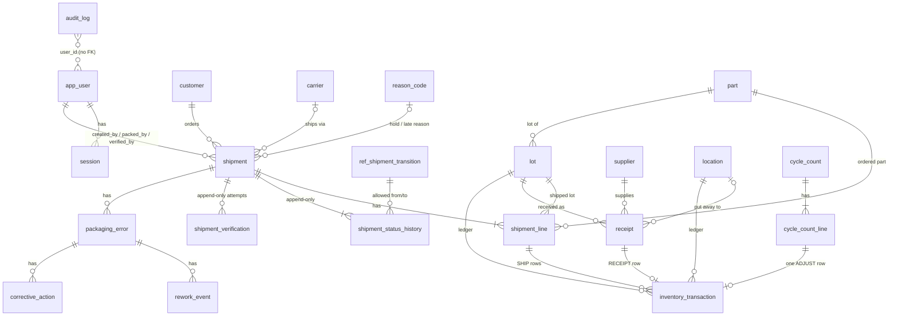

# Data Model — Version 1 (V1-CORE)

**Task:** T-012 · **Owner:** Dana (data-model-specialist) · **Date:** 2026-11-26 · **Status:** DRAFT for review by Marcus (architecture, Q-A decision), Diego (API), Kenji (KPIs), Sasha (security)
**Inputs:** [project-scope.md](../project-scope.md) §3, [plan/backlog.md](../plan/backlog.md) §3.1 (V1-CORE only), [plan/permissions-matrix.md](../plan/permissions-matrix.md) (final), [security/security-plan.md](../security/security-plan.md), [api/contract.md](../api/contract.md) (DRAFT 2), [design/ui-spec.md](../design/ui-spec.md), [ADR-001](../ADR-001.md) §5, [08](../08-data-model-forms-charts-reports.md) §8.2, [03](../03-inventory-management.md), [05](../05-performance-metrics.md).
Companion documents: [migrations-plan.md](migrations-plan.md) (the full DDL, expand/contract), [seed-plan.md](seed-plan.md) (seed, fixtures, reset).
Tags: **[R]** researched, **[A]** assumption, **[P]** proposed. All data is **fictional** (Cobalt Ridge Components, Inc.).

> **Design only.** No migration file, seed code or application code exists yet. The DDL in `migrations-plan.md` section 3 was nevertheless **executed** on an in-memory PGlite (PostgreSQL 17 engine of `@netlify/database-dev`) and exercised with 44 assertions, so the SQL in these documents is syntactically valid and behaves as described. It has not run on Netlify's hosted database.

## 1. Entity-relationship diagram



Standalone: `login_attempt`, `audit_log` (no foreign keys, so a demo reset can never be blocked by them), `setting`. Views: `v_on_hand`, `v_on_hand_detail`, `v_shipment_delivery`, `v_shipment_quality`, `v_inventory_transaction`.

**24 tables and 5 views** in migration 0001. Name mapping to other documents: `users` (ADR-001, security plan) = `app_user` (`user` is reserved in SQL); `sessions` = `session`; `login_attempts` = `login_attempt`; `settings` = `setting`. All table names are singular, following docs/08 and the PoC.

## 2. Conventions

| Topic | Rule |
|-------|------|
| Keys | `id bigint GENERATED ALWAYS AS IDENTITY` primary key everywhere. Business keys are separate `UNIQUE` text columns: `shipment_no` (`SH-1001`, sequence starts at 1001), `error_no` (`PE-0001`), `receipt_no` (`RC-0001`), `count_no` (`CC-0001`), `part_number`, `username`, lot number. The number sequences are `OWNED BY` their column, so `TRUNCATE ... RESTART IDENTITY` resets them. The seed inserts ids and numbers explicitly (`OVERRIDING SYSTEM VALUE`) and then advances the sequences with `setval`. |
| Types | `timestamptz` (UTC) for instants, `date` for calendar dates (order, requested, promise, ship, due, scheduled, `business_date`), `integer` quantities (units are whole pieces; `unit_of_measure` defaults `EA`), `numeric(10,2)` weight, `numeric(5,2)` tolerance percent, `jsonb` only for the verification checklist and audit `changes`, `text[]` for failed checklist items, `uuid` for the TRANSFER group. Enumerations are `text` + named `CHECK` (no `CREATE TYPE`), so widening is a constraint swap (migrations-plan section 5). |
| Timestamps | `created_at` / `updated_at` / session / audit times are **real** `now()` (`updated_at` is set by trigger). Business-event times follow the business-clock design in section 3. |
| Actor columns | `created_by`, `packed_by`, `verified_by`, `reported_by`, `received_by`, `performed_by`, `submitted_by`, `approved_by`, `counted_by`, `recounted_by`, `owner_id` are foreign keys to `app_user`. The **server** sets them from the session (Matrix R-12); the schema cannot enforce that. |
| Referential integrity | Every FK is enforced and `NO ACTION` (there are no `ON DELETE CASCADE` anywhere: nothing is ever deleted). |
| Lot integrity | `lot (lot_number UNIQUE, part_id)` plus `UNIQUE (part_id, lot_number)`. Ledger rows, receipts, shipment lines and count lines carry a composite FK `(part_id, lot_number) -> lot`, so a lot number can never be used with a different part, and an unknown lot is rejected. |
| Ledger links | `inventory_transaction` carries typed, nullable FKs instead of the polymorphic `reference_type/reference_id` of docs/08: `receipt_id`, `shipment_line_id`, `cycle_count_line_id`, each as a **composite FK that includes part, location and lot** (a SHIP row must be for the same part, lot and location as its shipment line). The view `v_inventory_transaction` derives the API's `reference_type` / `reference_id`. |
| Delete policy | No business row is ever deleted. A `BEFORE DELETE` trigger (`reject_delete`) enforces it at the database level on every business table; `session` and `login_attempt` may be deleted (logout, cleanup), and `shipment_line` rows may be deleted only while the shipment is `Planned` or `Ready to Pack` (edit of lines, E-08). Lookups use `active`. **Soft delete (`archived_at`)** is deferred with US-010 (migration 0003). |
| Append-only | `audit_log`, `shipment_status_history`, `shipment_verification`, `inventory_transaction`: `BEFORE UPDATE OR DELETE ... RAISE EXCEPTION` (SQLSTATE `restrict_violation`, class 23), as proven in the PoC. `TRUNCATE` stays allowed (demo reset). Holds even if the application connects as the owner. |
| Case and format | `username` lower-case; lot numbers upper-case by CHECK; emails must end in `@example.com` (guardrail enforced by the database). |

## 3. Business clock, settings and the fixed reporting date (Q-23 / Q-A) [P]

### 3.1 Design implemented in 0001 (Option A, as in the API contract section 1.6)

- Settings `reporting_mode` (`fixed`|`live`) and `reporting_date` (default `fixed` / `2026-11-25`).
- The **server** (one helper module, not SQL) computes `business_today` (the reporting date in fixed mode, else the real UTC date) and `business_now` (`business_today` + real UTC time of day in fixed mode). **No SQL function duplicates this rule**, so there is one implementation.
- **Records store the real clock**: `created_at`, `updated_at`, audit `at`, `shipment_status_history.changed_at`, `shipment_verification.verified_at`, `rework_event.completed_at`, `cycle_count.submitted_at/approved_at`, `inventory_transaction.txn_at`, `shipment.shipped_at` all default to `now()`.
- **KPI period anchors** that must follow the fixed date are **separate `date` columns**, written by the server from `business_today`:

| Column | Anchors | Used by |
|--------|---------|---------|
| `shipment_status_history.business_date` (NOT NULL) | date of each status change | list/timeline display; KPI-6 start is the first `Ready to Pack` row (its timestamp, not its business date) |
| `shipment_verification.business_date` (NOT NULL) | verification date | KPI-3 and KPI-4 period (first attempt) |
| `rework_event.completed_business_date` (NULL while in progress) | completion date | KPI-5 period |
| `cycle_count.approved_business_date` (NULL until approved) | approval date | KPI-7 period |

- Dates that are already business-clock values: `order_date`, `requested_date`, `promise_date`, `ship_date`, `due_date`, `scheduled_date`, and the user-entered timestamps `detected_at`, `started_at`, `arrived_at` (no database default; the app passes `business_now`, contract sections 1.6, 6, 7).
- The dashboard default period is `[business_today - 29, business_today]` inclusive (`default 30 days`, contract E-48). Period filters on `timestamptz` use the half-open interval `>= :from::date` and `< (:to::date + 1)` in UTC; filters on `date` columns use `BETWEEN :from AND :to`.
- **No column of the schema has a default that reads the business clock**; only the application writes business values.

### 3.2 Alternative (Option B) for Marcus's decision

Store **event timestamps** as `business_now` (reporting date + real time of day) and drop the four `business_date` columns. Advantages: one timestamp per event; KPI queries filter on the timestamp itself; no second column to keep in sync. Disadvantages found: (1) a live record gets a timestamp that is **before** seeded records of the same calendar day only if the seed contained events on the reporting date; the seed avoids this (all seed events are before `2026-11-25T00:00:00Z`), but switching the mode from `live` back to `fixed` after live use makes the clock go **backwards**, which `status_history_chain_check` (non-decreasing per shipment) would reject; (2) `shipped_at` minus `ready_to_pack_at` stays consistent only while both use the same clock; (3) audit and event times no longer agree, which complicates support. **Choose before 0001 is applied anywhere shared** (migrations-plan section 2). Switching later costs an expand/contract pair.

### 3.3 Problems found with the provisional rule (any option)

1. **Mixed clocks in one episode.** Contract E-18/E-24/E-30 default `detected_at`, `started_at`, `arrived_at` to `business_now`, while E-25 sets `completed_at` and every status/verification/ledger row use the real `now()`. A rework event started at `2026-11-25T14:00Z` (business) and completed at `2026-11-26T14:05Z` (real, entered the next day) yields `minutes = 1445`. The generated `minutes` column and `completed_at >= started_at` CHECK assume one clock. **Recommendation for Diego/Marcus:** take both rework times from the same clock (both `business_now`, or both user-entered), and compute `completed_business_date` from the same value.
2. **Switching modes.** Fixed -> live leaves a gap between the reporting date and the real date (no data, charts show empty weeks); live -> fixed puts the default window in the past relative to live records, which then drop out of KPI periods (they are *after* the reporting date). **Proposed guard [P]:** `PATCH /settings/reporting` (Admin only) warns, and the Admin demo reset restores `fixed` / `2026-11-25`.
3. **`reporting_date` earlier than existing data.** An Admin can set a past date; open-shipment "overdue" and every default period then move, but history is unchanged. Allowed; audited.
4. **Real clock before the seed.** `status_history_chain_check` requires non-decreasing `changed_at` per shipment; seed timestamps end before 2026-11-25. A machine whose clock is earlier than that cannot append history. Not a real risk after 2026-11-25.
5. **`business_date` can disagree with the timestamp's UTC date by design** (live records on 2026-11-26 carry `business_date = 2026-11-25`). Reports that show both must label which is which (UI: Maya's audit screen already states the basis).
6. **`ship_date` after `shipped_at`'s date is allowed** (fixed date in the future of the real date is possible if an Admin sets one); no CHECK ties them.

### 3.4 Settings table

`setting (key PK, value text, default_value text, value_type, scope, min_value, max_value, description, updated_by, updated_at)`.

- `scope = 'config'`: shown and editable per the permissions matrix (targets/tolerances: Supervisor and Admin; reporting mode/date: Admin only). `value_type` and `min_value`/`max_value` are enforced by `CHECK` (a number must match the pattern and lie in range; booleans `true|false`; dates `YYYY-MM-DD`; `reporting_date` must be a real date between 2000-01-01 and 2100-12-31; `reporting_mode` in `fixed|live`; `on_time_basis` in `promise|requested`). The API validates first (Zod), the database is the backstop.
- `scope = 'system'`: never listed by `GET /settings`, never reset: `client_key_salt` (random per database, generated in the migration, security plan 3.3) and `last_demo_reset_at` (demo-reset cooldown, matrix R-9; empty = never). Diego's `last_demo_reset_at` request (contract 14.1 #5) is implemented as this system setting.
- `default_value` holds the factory default so the demo reset can run `UPDATE setting SET value = default_value WHERE scope = 'config'` and **the defaults exist in one place only (the migration)**.
- `updated_by` is a plain `bigint` (no FK) so a reset that truncates users cannot be blocked and `setting` can survive a reset.

Rows created by 0001 (keys exactly as contract section 8): `reporting_mode`, `reporting_date`, `on_time_basis`, `on_time_tolerance_days`, `target_on_time_pct` (95), `target_otif_pct` (93), `target_pkg_error_rate_pct` (2), `target_fpy_pct` (98), `target_rework_freq_pct` (2), `target_cycle_time_h` (24), `target_inventory_accuracy_pct` (97), `target_dock_to_stock_h` (8, KPI-8 deferred, kept because US-008 lists it), `tolerance_a_pct` (0), `tolerance_b_pct` (2), `tolerance_c_pct` (5), `demo_read_only_mode` ([P], security plan PD-7, default false), plus the two system rows.

## 4. Table reference

Legend: **PK** primary key, **FK** foreign key, **U** unique, req = NOT NULL. Only constraints that carry meaning are listed; the DDL is authoritative. "Story" = V1-CORE backlog card.

### 4.1 Auth, audit, settings (US-001, US-003, US-005, US-008, US-011)

**`app_user`** — `id`, `username` U (`^[a-z0-9][a-z0-9._-]{2,39}$`), `display_name` req, `email` (only `@example.com`), `role` req (`Admin|Supervisor|Shipping|Receiving|Quality|Viewer`), `password_hash` (`scrypt$...` string, security plan 3.1), `active` (default true), `last_login_at`, `created_at`, `updated_at`. CHECK: an **active user must have a password hash** (this is how the deployed `demo.admin` is created *inactive with no hash* when `DEMO_ADMIN_PASSWORD` is unset). One role per user (single column; R-11). The role and `active` flag are read from this row on every request. No delete.

**`session`** (contract/Sasha `sessions`) — `id`, `token_hash bytea` U (SHA-256, 32 bytes), `user_id` FK req, `csrf_token` req (>= 32 chars, synchronizer token), `created_at`, `last_seen_at`, `expires_at` req (absolute 8 h; the 30-minute idle rule is `last_seen_at + 30 min`, checked by the app), optional `write_window_start` / `write_count` ([P], per-session write cap, security plan PD-5). **No anonymous rows** (no pre-login token). Logout deletes the row; deactivation or role change deletes all of the user's rows. Indexes: `user_id`, `expires_at` (cleanup). `last_seen_at` is updated at most every 5 minutes (security plan 3.2).

**`login_attempt`** (`login_attempts`) — `key text` (salted SHA-256 hex of `username+client` or of `client` alone, computed by the app with the `client_key_salt` setting), `window_start timestamptz` (start of the 15-minute bucket), `fail_count`, `updated_at`; **PK (`key`, `window_start`)**. Upsert `ON CONFLICT (key, window_start) DO UPDATE SET fail_count = fail_count + 1`. Rows older than 24 hours are deleted on write (privacy, PD-9). No raw IP and no raw username is stored.

**`audit_log`** — `id`, `at` (real UTC), `user_id bigint` (**no FK**), `action` (`^[A-Z][A-Z0-9_]{1,59}$`, the enumeration in contract 1.8), `table_name`, `record_id text`, `changes jsonb` (`{field: [old, new]}`; for `ACCESS_DENIED` the denial fields). **Append-only** by trigger; **no IP column** (security plan section 9); never holds passwords, tokens or CSRF values (an app rule). Indexes: `(at DESC, id DESC)`, `(table_name, record_id)`, `(user_id, at DESC)`, `(action, at DESC)`. The Admin screen reads it newest first (US-005).

**`setting`** — section 3.4.

### 4.2 Lookups (US-007, US-011)

| Table | Columns | Constraints |
|-------|---------|-------------|
| `customer` | `id`, `code` U, `name`, `ship_to_city`, `ship_to_state`, `active`, `created_at`, `updated_at` | code `^[A-Z0-9-]{1,20}$`, name 1..100 |
| `supplier` | `id`, `code` U, `name`, `active`, timestamps | same patterns |
| `carrier` | `id`, `name` U, `mode` (`Parcel|LTL|Truckload|Pickup`), `active`, timestamps | no `code` column (contract has none); tracking requirement is derived from `mode <> 'Pickup'` |
| `part` | `id`, `part_number` U, `revision`, `description`, `unit_of_measure` (default `EA`), `abc_class` (`A|B|C`, req), `packaging_instruction_ref`, `requires_coc`, `active`, timestamps | `part_number ~ ^[A-Z0-9][A-Z0-9-]{2,29}$`; `revision ~ ^[A-Z0-9]{1,10}$`; **`part_number LIKE '%-' || revision`** (revision is part of the identity: `CRC-2041-B` and `CRC-2041-C` are two rows; contract 14.14, UI 14.14) |
| `location` | `id`, `code` U, `type` (`Stock|Receiving|Hold|Shipping|FG`), `description`, `active`, timestamps | code 2..20. R-7 decides by `type`, never by a request flag |
| `reason_code` | `id`, `category` (`late|hold|adjust|scrap`), `code`, `label`, `active`, timestamps | `UNIQUE (category, code)`; code `^[A-Z0-9_]{2,30}$`. No owner department (it is stored per shipment hold, contract 14.6; UI 14.6 answered) |
| `lot` | `id`, `lot_number` U, `part_id` FK, `created_at` | `^[A-Z0-9][A-Z0-9-]{2,29}$` (contract Q-I); `UNIQUE (part_id, lot_number)` is the composite-FK target. The convention `L<yy><ww>-<nnn>` is applied by the **seed and a UI hint**, not enforced (UI 14.8) |

### 4.3 Shipping (US-014, US-016, US-019, US-020, US-021, US-024)

**`shipment`** — `id`; `shipment_no` U (`^SH-[0-9]{4,}$`, default from `shipment_no_seq`); `customer_id` FK; `customer_po` (1..40); `order_date`, `requested_date`, `promise_date` (dates, req); `status` (8 values); `held_from_status`, `hold_reason_id` FK, `hold_owner_dept` (`Shipping|Quality|Receiving|Production|Planning|Customer`) — **all three set together exactly when status is `On Hold`** (`shipment_hold_chk`) and cleared on release; `rework_origin` (`VERIFICATION_FAILED|ERROR_LOGGED|EDITED_AFTER_VERIFY`, required while `Rework`, may persist while `On Hold`/`Cancelled`, `shipment_rework_chk`); `rework_episode int` (**Q-K answer**: incremented by the server on every entry to `Rework`; see 4.4); `late_reason_id` FK; `ship_date`, `shipped_at`, `carrier_id` FK, `tracking_number` (`^[A-Za-z0-9-]{1,40}$`), `service_level` (<= 40), `packages_count` (>= 1), `total_weight_lb` numeric(10,2) (> 0); `doc_packing_slip`, `doc_bol`, `doc_coc`, `doc_labels`; `packed_by` FK (**the current packer**, set by `start-packing` and `reopen`); `verified_by`, `verified_at` (set by a passing verification, cleared on entry to Rework); `notes` (<= 1000); `created_by`, `created_at`, `updated_at`.
Constraints: `shipment_dates_chk` (promise and requested >= order date); `shipment_verified_chk` (`verified_by` and `verified_at` together; **`verified_by <> packed_by`**, so a verifier who is the current packer is impossible even if the API had a bug); `shipment_shipped_fields_chk` (ship fields only when `Shipped`, and when `Shipped` ship date, timestamp, carrier, packages, weight **and a verifier** are required: **no un-verified shipment can be Shipped**); `shipment_late_reason_chk` (a `Shipped` shipment with `ship_date > promise_date` must have a late reason; a late reason exists only on `Shipped`). Tolerance days are an app rule (the CHECK is stricter than a positive tolerance, which is what contract E-12 also requires of the late reason: `ship_date > promise_date + tolerance`; with tolerance > 0 a shipment inside the tolerance window but after the promise date needs a reason here. **Mismatch noted in section 10**).
Indexes: `ship_date` (partial, Shipped), `status`, `(customer_id, order_date)`, `carrier_id`, `promise_date` (partial, open), `packed_by`.

**`shipment_line`** — `id`, `shipment_id` FK, `line_no` (U with shipment), `part_id` FK, `qty_ordered` (> 0), `qty_shipped` (>= 0, null until shipped), `lot_number` (nullable until chosen), `location_id` FK (nullable until shipped), `short_note`, timestamps. Composite FK `(part_id, lot_number) -> lot`. CHECK: `qty_shipped < qty_ordered` requires a non-blank `short_note` (US-021). `UNIQUE (id, part_id, location_id, lot_number)` and `UNIQUE (id, shipment_id)` are FK targets (ledger SHIP rows and packaging errors). Revision comes from `part.revision` (no revision column on the line). Delete only while the shipment is Planned / Ready to Pack (trigger).

**`ref_shipment_transition`** — `(from_status, to_status)` PK; 23 rows inserted by the migration implementing contract section 1.7: Planned -> Ready to Pack -> Packing -> Verified -> Shipped; Packing/Verified -> Rework; Rework -> Packing; hold from Planned, Ready to Pack, Packing, Verified, Rework and back to each of those; cancel from every status before Shipped including On Hold and Rework. Owned by the migration (not truncated by the reset).

**`shipment_status_history`** (append-only) — `id`, `shipment_id` FK, `from_status` (NULL only on the first row), `to_status`, `changed_at` (real), `business_date` (req), `changed_by` FK, `note` (<= 500), `created_at`. **Composite FK `(from_status, to_status) -> ref_shipment_transition`** rejects an invalid transition at the database; CHECK: a NULL `from_status` only with `to_status = 'Planned'`. Trigger `status_history_chain_check`: `from_status` must equal the previous row's `to_status` and `changed_at` must not go backwards. The **first `Ready to Pack` row** is the KPI-6 start (view `v_shipment_delivery` takes `MIN(changed_at)`); because the table is append-only it can never be overwritten (US-016). Indexes `(shipment_id, changed_at, id)`, `(to_status, changed_at)`, `(business_date)`. `shipment.status` equals the last row's `to_status` (invariant checked by the seed validation and by a data test; the API writes both in one transaction).

**`shipment_verification`** (append-only; contract 14.1 #1) — `id`, `shipment_id` FK, `attempt_no` (U with shipment), `result` (`Pass|Fail`), `packer_id` FK (the packer **at that time**), `verified_by` FK, `checklist jsonb`, `failed_items text[]`, `note`, `verified_at` (real), `business_date` (req). CHECKs: **`verified_by <> packer_id`** (R-1, defence in depth; the API's 403 `VERIFIER_SAME_AS_PACKER` comes first); `checklist` is an object containing the seven always-required keys `part_number, revision, quantity, lot, labels, packing_slip, packaging_method` (`coc` is present only when applicable); `failed_items` is a subset of the eight keys; **`result = 'Pass'` exactly when `failed_items` is empty**. A refused attempt writes no row. FPY uses `attempt_no = 1` (indexes on `business_date`, partial on attempt 1). The checklist values are `pass|fail` strings as in the contract; the database does not cross-check `checklist` against `failed_items` (an app rule; a boolean-column design would, at the cost of a wider table, and was rejected to match the contract).

### 4.4 Packaging quality (US-027, US-029, US-030, US-032)

**`packaging_error`** — `id`, `error_no` U (`PE-0001`), `shipment_id` FK, `shipment_line_id` (composite FK with the shipment), `detected_at` (business_now by default, app-supplied), `rework_episode` (the shipment's `rework_episode` at logging; set only for Before-ship errors; Q-K), `detected_by_role` (`Packer|Verifier|Quality|Customer`), `detected_stage` (`Before ship|After ship`), `category` (8 values), `paperwork_subtype` (5 values), `severity`, `description` (1..1000), `root_cause_category` (6M), `root_cause_note` (the 5 Whys, <= 2000), `status` (`Open|Contained|Closed`), `closed_at`, `reported_by` FK, timestamps. CHECKs: `paperwork_subtype` present **iff** category is Paperwork; `closed_at` present iff Closed; `Customer` only with After ship; After ship only by `Quality` or `Customer` (contract E-18 [A]); `rework_episode` only for Before ship. `UNIQUE (id, shipment_id)` for the rework FK. Derived, never stored: `needs_recategorisation` (category = Other), `is_overdue` (Open and older than 7 days, vs `business_today`).
**Q-K answered.** The rework gate (contract 1.7 G1/G2) becomes an equality instead of a timestamp comparison: G1 = a Before-ship error with `rework_episode = shipment.rework_episode`; G2 = a completed `rework_event` for such an error. The server increments `shipment.rework_episode` in the same transaction that moves the shipment into Rework (verification failed, error logged on Packing/Verified, edit after verify), and stamps the new value on an error it logs in that transaction. Diego may keep the timestamp rule; the columns cost nothing and remove the same-transaction timestamp ambiguity.

**`rework_event`** — `id`, `packaging_error_id` + `shipment_id` (**composite FK to `packaging_error (id, shipment_id)`**, so the shipment cannot disagree with its error), `action` (6 values), `started_at`, `completed_at`, `completed_business_date` (set iff completed), `minutes integer GENERATED ALWAYS AS (floor(epoch(completed_at - started_at) / 60)) STORED` (null while in progress; excluded from totals), `performed_by` FK, `reverified_ok boolean` (server-managed, E-11), timestamps. CHECK `completed_at >= started_at`.

**`corrective_action`** — `id`, `packaging_error_id` FK, `action_description` (1..1000), `owner_id` FK req (**owner and due date are required**, UI 14.7), `due_date` req, `status` (`Open|In Progress|Closed`), `closed_at` (iff Closed), `created_by` FK, timestamps. `is_overdue` is derived (`due_date < business_today` and not Closed). Index `(status, due_date)`.

### 4.5 Inventory (US-035, US-037, US-041, US-043, US-044, US-045)

**`receipt`** — `id`, `receipt_no` U (`RC-0001`), `supplier_id` FK, `supplier_po` (1..40), `part_id` FK, `qty_received` (> 0), `lot_number`, `arrived_at` (business_now default, app-supplied), `location_id` FK, `inspection_status` (`Accepted|On Hold|Rejected`), `received_by` FK, `notes`, timestamps. Composite FK `(part_id, lot_number) -> lot`. CHECK: **`location_id` is NULL exactly when `Rejected`** (no on-hand is created). `UNIQUE (id, part_id, location_id, lot_number)` is the ledger FK target. `inspection_status` records the status **at receiving**; releasing held stock later is a ledger TRANSFER (R-7), not an update of the receipt (US-036 deferred). `putaway_at` is **not** in 0001 (deferred, US-064; the API returns `null`).

**`inventory_transaction`** (append-only ledger) — `id`, `txn_type` (`RECEIPT|SHIP|TRANSFER|PRODUCTION_COMPLETE|SCRAP|ADJUST`; no ISSUE, Q-17), `part_id`, `location_id`, `lot_number` (req), `qty_change` (signed, `<> 0`), `reason_code_id`, `receipt_id`, `shipment_line_id`, `cycle_count_line_id` (typed links, composite FKs including part/location/lot), `txn_group uuid` (links the two TRANSFER legs), `note`, `txn_at` (real), `created_by` FK, `created_at`.
Per-type CHECKs: RECEIPT `qty > 0` and `receipt_id`; SHIP `qty < 0` and `shipment_line_id`; PRODUCTION_COMPLETE `qty > 0`; SCRAP `qty < 0` and a reason; **ADJUST needs a reason and a `cycle_count_line_id`** (`inventory_transaction_adjust_chk`, relaxed by US-040 in migration 0005); TRANSFER needs `txn_group`; each link column is allowed only for its own type. **A partial unique index allows at most one ADJUST per count line**, which implements "no second adjustment on a repeated approval" (E-40, `ALREADY_APPROVED`) at the database. The contract's `adjustment_txn_id` on the count line is **derived** (`ledger.cycle_count_line_id = line.id`) rather than stored (a stored copy would need an UPDATE of the line and a circular reference).
Deferred constraint triggers (checked at COMMIT): **`inventory_transaction_nonnegative`** (on-hand of the (part, location, lot) never negative; takes `pg_advisory_xact_lock(hashtextextended(key))` so two concurrent postings are serialized) and **`inventory_transaction_transfer_balanced`** (a TRANSFER group has exactly two legs summing to zero). The API's own sorted `pg_advisory_xact_lock(part, hash(lot))` (contract 1.9) uses the two-argument key space and so does not collide with the trigger's one-argument key; because the API serializes first, the trigger is a backstop and is not expected to wait. The check proves the **end state**; "stock covered the ship at ship time" is verified by the running-balance query in seed-plan section 9. Indexes: `(part_id, location_id, lot_number)`, `(lot_number, txn_at, id)`, `(txn_at)`, partial on `shipment_line_id`, `receipt_id`, `txn_group`.

**`cycle_count`** — `id`, `count_no` U (`CC-0001`), `scheduled_date`, `status` (`Open|Counted|Approved`), `scope_abc_class`, `scope_location_id` FK, `created_by`, `submitted_by` + `submitted_at` (set on submit), `approved_by` + `approved_at` + **`approved_business_date`** (set together on approval), `approval_reason_code_id` FK (the adjust reason of E-40), `approval_note`, timestamps. CHECKs tie each status to its fields; **`approved_by <> submitted_by`**. Trigger `cycle_count_approval_guard` (BEFORE UPDATE): an **Approved count is terminal**, and approval is refused when the approver **counted or recounted any line** (Matrix R-4, `APPROVER_SAME_AS_COUNTER`; the API checks first and returns 403). Index on `approved_business_date` (partial, Approved).

**`cycle_count_line`** — `id`, `cycle_count_id` FK, `part_id`, `location_id`, `lot_number` (U per count, composite FK to `lot`), `abc_class` and `tolerance_pct` (**snapshots** taken at count creation, so a later setting change does not restate history), `system_qty` (snapshot, **never shown to counters**: absent from the API response for Open counts), `counted_qty`, `counted_by`, `counted_at`, `recount_qty`, `recounted_by`, `recounted_at` (**both counter columns required for R-4**), and generated columns: `final_qty = COALESCE(recount_qty, counted_qty)`, `first_variance_qty = counted_qty - system_qty`, `variance_qty = final_qty - system_qty`, `first_in_tolerance` and `final_in_tolerance` (`abs(qty - system_qty) * 100 <= system_qty * tolerance_pct`, exact integer/numeric arithmetic). CHECKs: a quantity and its actor columns appear together; a recount requires a count. **KPI-7 Q-D:** the contract uses `first_in_tolerance`; both exist so Kenji can choose (section 8).

### 4.6 Views

| View | Rows | Used for |
|------|------|----------|
| `v_on_hand` | one per (part, location, lot) with `SUM(qty_change) <> 0` | the on-hand view (docs/08); a view, **never a stored column** |
| `v_on_hand_detail` | `v_on_hand` + part number/description/ABC, location code/type, `on_hold` | R4 and E-32 |
| `v_shipment_delivery` | one per **Shipped** shipment: `ship_date`, `shipped_at`, `days_late_vs_promise`, `days_late_vs_requested`, `in_full`, `ready_to_pack_at` (first Ready to Pack), `cycle_hours` | KPI-1, KPI-2, KPI-6, R1 |
| `v_shipment_quality` | one per **non-cancelled** shipment: status, `ship_date`, first verification (`first_verified_at`, `first_verified_business_date`, `first_result`), `error_count`, `internal_error_count` (Before ship), `escape_error_count` (After ship) | KPI-3, KPI-4, C2 |
| `v_inventory_transaction` | ledger row + `reference_type` (`receipt|shipment|cycle_count|manual`) and `reference_id` (receipt id, **shipment id**, count id) | contract section 7 |

Tolerance (days) and basis (promise or requested) are **applied by the KPI module**, not by the views, so the views never hold a second copy of a setting.

## 5. On-hand and lot-trace queries

```sql
-- On-hand by part / location / lot (R4, E-32): the view
SELECT part_number, location_code, lot_number, qty_on_hand
  FROM v_on_hand_detail ORDER BY part_number, location_code, lot_number;

-- Backward trace: where did lot $1 come from? (receipt rows incl. Rejected, which have no ledger row)
SELECT r.receipt_no, r.arrived_at, s.code AS supplier_code, s.name AS supplier, r.supplier_po,
       p.part_number, r.qty_received, r.inspection_status
  FROM receipt r JOIN supplier s ON s.id = r.supplier_id JOIN part p ON p.id = r.part_id
 WHERE r.lot_number = $1 ORDER BY r.arrived_at, r.id;
-- In-house lots (no supplier receipt):
SELECT t.txn_at, t.qty_change, u.display_name AS produced_by
  FROM inventory_transaction t JOIN app_user u ON u.id = t.created_by
 WHERE t.lot_number = $1 AND t.txn_type = 'PRODUCTION_COMPLETE' ORDER BY t.txn_at, t.id;

-- Forward trace: which shipments consumed lot $1? (from the ledger, so it reconciles with on-hand)
SELECT sh.shipment_no, sh.id AS shipment_id, c.code AS customer_code, c.name AS customer,
       sh.ship_date, -t.qty_change AS qty_shipped, ca.name AS carrier, sh.tracking_number, sh.status
  FROM inventory_transaction t
  JOIN shipment_line sl ON sl.id = t.shipment_line_id
  JOIN shipment sh      ON sh.id = sl.shipment_id
  JOIN customer c       ON c.id = sh.customer_id
  LEFT JOIN carrier ca  ON ca.id = sh.carrier_id
 WHERE t.txn_type = 'SHIP' AND t.lot_number = $1
 ORDER BY sh.ship_date, sh.shipment_no, t.id;

-- All movements of the lot, chronological (transfers, scrap, adjustments included)
SELECT t.txn_at, t.txn_type, l.code AS location, t.qty_change, rc.code AS reason_code
  FROM inventory_transaction t JOIN location l ON l.id = t.location_id
  LEFT JOIN reason_code rc ON rc.id = t.reason_code_id
 WHERE t.lot_number = $1 ORDER BY t.txn_at, t.id;

-- Reconciliation line (summary of E-41)
SELECT SUM(qty_change) FILTER (WHERE txn_type IN ('RECEIPT','PRODUCTION_COMPLETE'))::int AS received_total,
       -SUM(qty_change) FILTER (WHERE txn_type = 'SHIP')::int   AS shipped_total,
       -SUM(qty_change) FILTER (WHERE txn_type = 'SCRAP')::int  AS scrapped_total,
       SUM(qty_change) FILTER (WHERE txn_type = 'ADJUST')::int  AS adjusted_total,
       SUM(qty_change)::int                                     AS on_hand_total
  FROM inventory_transaction WHERE lot_number = $1;
```

Verified on the hand fixture C (seed-plan section 11): lot `L2611-004`, receipt 100 (RC-0001, Graystone Metals Supply) -> SH-3001 Aldervale 40, SH-3002 Pinecrest 25, scrap 5, 30 on hand: received 100 = shipped 65 + scrapped 5 + on hand 30. Indexes backing the trace: `receipt (lot_number)`, `shipment_line (lot_number)`, `inventory_transaction (lot_number, txn_at, id)`.

## 6. Triggers and integrity summary

| Mechanism | Where | Purpose |
|-----------|-------|---------|
| `reject_mutation` | `audit_log`, `shipment_status_history`, `shipment_verification`, `inventory_transaction` | append-only (R-10) |
| `reject_delete` | 17 business, lookup and reference tables | never delete (soft delete deferred) |
| `shipment_line_delete_guard` | `shipment_line` | line removal only while Planned/Ready to Pack |
| `set_updated_at` | 16 mutable tables | real `updated_at` |
| `status_history_chain_check` | `shipment_status_history` | chain and non-decreasing time |
| FK `(from_status, to_status)` | `shipment_status_history` -> `ref_shipment_transition` | valid state machine |
| `cycle_count_approval_guard` | `cycle_count` | R-4, Approved is terminal |
| `inventory_transaction_nonnegative` (deferred) | ledger | no negative on-hand |
| `inventory_transaction_transfer_balanced` (deferred) | ledger | two balanced TRANSFER legs |
| CHECKs | see 4.x | R-1 (`verified_by <> packer_id`, `verified_by <> packed_by`), no Shipped without verification, late reason, paperwork subtype, status/field consistency |

Rules that **cannot** be a database constraint and stay in the API (listed so nobody assumes otherwise): role permissions; the verifier identity at request time (the CHECK is only a backstop); carrier/tracking rule (`Pickup` needs no tracking); location type for SHIP/receipt/production (Stock, FG, Shipping...); R-7 (movement out of a Hold location); tolerance days; `due_date >=` error date; active-only references; the "5 minute future" limits.

## 7. Indexes for KPI and report queries

| Query | Index |
|-------|-------|
| KPI-1/2/6, C1, R1 (period on `ship_date`) | `shipment_ship_date_idx` (partial, Shipped); history `(shipment_id, changed_at, id)` for the first Ready to Pack |
| KPI-3/4, C2 (first verification date) | `shipment_verification_first_idx` (`business_date` where `attempt_no = 1`), `shipment_verification (shipment_id, attempt_no)` unique |
| KPI-3 errors, C3, R3 | `packaging_error (detected_at)`, `(category)`, `(shipment_id)`, `(status)` partial |
| KPI-5 | `rework_event (completed_business_date)` partial, `(packaging_error_id)` |
| KPI-7 | `cycle_count (approved_business_date)` partial, `cycle_count_line (cycle_count_id)` |
| On-hand, stock check | ledger `(part_id, location_id, lot_number)` |
| Lot trace R7 | ledger `(lot_number, txn_at, id)`, `receipt (lot_number)`, `shipment_line (lot_number)` |
| Shipment list filters (E-05) | `status`, `(customer_id, order_date)`, `carrier_id`, open `promise_date` partial |
| Audit screen | `(at DESC, id DESC)`, `(table_name, record_id)`, `(user_id, at DESC)`, `(action, at DESC)` (cooldown lookup) |
| Sessions / throttle cleanup | `session (expires_at)`, `(user_id)`; `login_attempt (window_start)` |

At the seeded volume (about 4,000 rows) every query is cheap; the indexes document intent and keep reports fast as the demo data grows.

## 8. KPI support matrix and reference queries

Every V1-CORE KPI, chart and report has its inputs in the schema. These queries are the **oracle** used to compute the hand-fixture expectations (seed-plan section 11); they are tested against fixtures A, B and C. Kenji's single KPI module is the implementation; if it disagrees with a query below, resolve it in `docs/05`.

| ID | Needs | Source |
|----|-------|--------|
| KPI-1 On-time % | `ship_date`, `promise_date` or `requested_date`, tolerance, basis | `v_shipment_delivery` |
| KPI-2 OTIF % | + every line `qty_shipped >= qty_ordered` | `v_shipment_delivery.in_full` |
| KPI-3 Error rate, errors per 100, internal vs escape | shipments verified or shipped in period, errors, stage | `v_shipment_quality` |
| KPI-4 FPY | first verification (attempt 1) result, error count | `v_shipment_quality` |
| KPI-5 Rework frequency, minutes | rework events completed in period, shipped count | `rework_event` |
| KPI-6 Cycle time median/P90 | first Ready to Pack timestamp, `shipped_at` | `v_shipment_delivery.cycle_hours` |
| KPI-7 Inventory accuracy | approved count lines | `cycle_count_line` + `cycle_count` |
| C1, C2, C3, R1, R3, R4, R7 | as above plus `shipment`, `packaging_error.category`, `v_on_hand_detail`, section 5 | |

```sql
-- KPI-1, KPI-2, KPI-6 (period on ship_date; $3 = tolerance days; percentages with one decimal; NULL when empty)
SELECT COUNT(*) AS shipped,
  round(100.0 * COUNT(*) FILTER (WHERE days_late_vs_promise <= $3) / NULLIF(COUNT(*), 0), 1) AS on_time_pct,
  round(100.0 * COUNT(*) FILTER (WHERE days_late_vs_promise <= $3 AND in_full) / NULLIF(COUNT(*), 0), 1) AS otif_pct,
  percentile_cont(0.5) WITHIN GROUP (ORDER BY cycle_hours) AS median_cycle_h,
  percentile_cont(0.9) WITHIN GROUP (ORDER BY cycle_hours) AS p90_cycle_h   -- linear interpolation [A]
  FROM v_shipment_delivery WHERE ship_date BETWEEN $1 AND $2;

-- KPI-3 and KPI-4 (period: first verification business date, or ship date for the KPI-3 denominator [A, Kenji to confirm])
SELECT COUNT(*) FILTER (WHERE first_verified_business_date BETWEEN $1 AND $2 OR ship_date BETWEEN $1 AND $2) AS denominator_kpi3,
       COUNT(*) FILTER (WHERE (first_verified_business_date BETWEEN $1 AND $2 OR ship_date BETWEEN $1 AND $2) AND error_count > 0) AS shipments_with_error,
       SUM(error_count) FILTER (WHERE first_verified_business_date BETWEEN $1 AND $2 OR ship_date BETWEEN $1 AND $2) AS errors,
       SUM(internal_error_count) AS internal_catches, SUM(escape_error_count) AS customer_escapes,
       COUNT(*) FILTER (WHERE first_verified_business_date BETWEEN $1 AND $2) AS verified,
       COUNT(*) FILTER (WHERE first_verified_business_date BETWEEN $1 AND $2 AND first_result = 'Pass' AND error_count = 0) AS first_pass_no_error
  FROM v_shipment_quality;

-- KPI-5 (events completed in period; divide by shipments shipped in period)
SELECT COUNT(*) AS rework_events, SUM(minutes) AS total_minutes, round(AVG(minutes), 2) AS avg_minutes
  FROM rework_event WHERE completed_business_date BETWEEN $1 AND $2;

-- KPI-7 (approved counts, period on approved_business_date; Q-D: first vs final)
SELECT round(100.0 * COUNT(*) FILTER (WHERE l.first_in_tolerance) / NULLIF(COUNT(*), 0), 1) AS accuracy_first_count_pct,
       round(100.0 * COUNT(*) FILTER (WHERE l.final_in_tolerance) / NULLIF(COUNT(*), 0), 1) AS accuracy_after_recount_pct,
       SUM(abs(l.variance_qty)) AS absolute_variance_units
  FROM cycle_count_line l JOIN cycle_count c ON c.id = l.cycle_count_id
 WHERE c.status = 'Approved' AND c.approved_business_date BETWEEN $1 AND $2 AND l.counted_qty IS NOT NULL;
```

Exclusions: cancelled shipments are excluded by both views (`v_shipment_delivery` only holds Shipped rows). Division by zero returns NULL (`NULLIF`), never 0 or 100. Partial shipments are separate shipments (scope 7) except a short line, which fails `in_full`.

## 9. Auth, session and audit support (coordination with Sasha and Diego)

| Security plan / contract item | Schema support |
|-------------------------------|----------------|
| scrypt hash as one self-describing string | `app_user.password_hash` (`scrypt$...`); inactive-without-hash allowed (`demo.admin` on the deployed site without `DEMO_ADMIN_PASSWORD`) |
| DB-backed sessions, SHA-256 of token, idle 30 min / absolute 8 h, rotate on login, delete on logout | `session` (`token_hash`, `last_seen_at`, `expires_at`); 5-minute `last_seen_at` throttle is app logic |
| Synchronizer CSRF token stored with the session | `session.csrf_token` |
| Login rate limit per (username, client) 5 / 15 min and per client 30 / 15 min, no lockout, salted client hash, 24 h cleanup | `login_attempt` + `setting.client_key_salt` |
| Audit: no IPs, no passwords/tokens, append-only, unknown usernames not stored | `audit_log` has no IP column and no FK; the username rule is the API's (see section 10) |
| Demo reset cooldown (matrix R-9) | system setting `last_demo_reset_at` |
| Read-only kill switch (PD-7, [P]) | `setting.demo_read_only_mode` |
| One role per user, last-Admin guard (R-11) | single `role` column; the last-Admin rule is an app rule (screen deferred) |
| Actor fields from the session (R-12) | actor FK columns; enforced in the API |

## 10. Mismatches with the API contract / UI spec

Items where the schema differs from `docs/api/contract.md` (DRAFT 2) or `docs/design/ui-spec.md`, or where the documents disagree. Nothing was diverged silently; each item names an owner.

| # | Mismatch | Schema choice | Owner |
|---|----------|---------------|-------|
| 1 | Contract 14.1 #3 asks for `cycle_count_line.adjustment_txn_id` | **Not stored.** Derived from `inventory_transaction.cycle_count_line_id` (unique per line). Avoids a circular reference and an UPDATE of the line. | Diego |
| 2 | Contract ledger shape has `reference_type` / `reference_id` (docs/08) | Typed FK columns instead; view `v_inventory_transaction` produces the contract shape (`reference_id` = **shipment id**, not line id) | Diego |
| 3 | `putaway_at` in the contract's Receipt shape | Column not in 0001 (US-064 deferred, migration 0004); API returns `null` | Diego |
| 4 | Contract/Sasha table names `users`, `sessions`, `login_attempts`, `settings` | `app_user`, `session`, `login_attempt`, `setting` (singular convention; `user` is a reserved word) | Diego, Sasha |
| 5 | Contract 14.2 Q-M: "reset audit row re-inserted after the reseed" (reset truncates `audit_log`) | **Recommendation: do not truncate `audit_log` on reset.** It has no FK, the earlier `DEMO_RESET` row then survives (security plan test S-29) and the cooldown history is kept. The seed-plan reset list excludes it. If the team prefers truncation, add `audit_log` to the TRUNCATE list and re-insert the row; the schema supports both. | Diego, Sasha |
| 6 | Demo-reset spacing: contract E-52 "minimum 60 s", matrix R-9 / security plan PD-3 "10 minutes" | Not a schema matter; `last_demo_reset_at` supports either. Matrix is authoritative (10 min). | Diego |
| 7 | Contract 1.8: failed login records the attempted username (<= 64 chars); security plan section 9: only if it matches an existing user, else `unknown` | Not a schema matter (`changes` is free `jsonb`); the stricter security-plan rule is recommended | Diego, Sasha |
| 8 | Contract 1.6 mixes clocks: user-entered times default to `business_now`, event times are real | See 3.3 item 1: rework start/complete must use one clock | Diego, Marcus |
| 9 | Contract E-12: late reason required when `ship_date > promise_date + tolerance`; the database CHECK requires a late reason when `ship_date > promise_date` | With tolerance 0 (default) identical. With tolerance > 0, a ship date inside the window needs a reason in the database but not in the API. Either relax the CHECK in a migration (drop `shipment_late_reason_chk`) or make the API require it. Recommended: **keep tolerance at 0 in v1** (Q for Kenji/Priya) | Diego, Kenji |
| 10 | Contract Q-I formats: part number "3..30" and revision "1..10" free text; no rule that the revision is the part number's suffix | DB requires `^[A-Z0-9][A-Z0-9-]{2,29}$`, revision `^[A-Z0-9]{1,10}$` and `part_number LIKE '%-' || revision`. The API's Zod rules must be at least as strict (or drop the LIKE check) so no valid API request can cause a 500. | Diego |
| 11 | Contract 1.7 gate G1/G2 by timestamps | `shipment.rework_episode` and `packaging_error.rework_episode` added (answers Q-K); optional for Diego to use | Diego |
| 12 | Contract E-18 `detected_by_role` rules | Encoded as CHECKs (Customer only After ship; After ship only Quality/Customer). If Diego relaxes the rule, the CHECK must change in a migration. | Diego |
| 13 | Contract E-12 `qty_shipped` 0..`qty_ordered`, `location_id` type Stock/FG/Shipping | Quantity bound is a CHECK on `>= 0` only; the upper bound and location type are app rules | Diego |
| 14 | `shipment.verified_by` required for Shipped (`shipment_shipped_fields_chk`) | Matches E-12 ("status must be Verified"); the seed provides it. A migration that ever allows shipping without verification would break the check by design. | Diego |
| 15 | Contract Q-D: KPI-7 on the **first** count | Both `first_in_tolerance` and `final_in_tolerance` are stored; recommendation in seed-plan: report first-count as the headline, recount as the second number (docs/03 3.3 secondary number) | Kenji |
| 16 | Backlog US-012 mentions "a small number Delivered"; Delivered is deferred (US-026) | The seed contains **no Delivered** shipments (status not in the CHECK until migration 0002) | Priya |
| 17 | UI 14.6 hold owning department: "data model only has hold_reason_id" | Resolved: `shipment.hold_owner_dept` (contract 14.6); reason codes carry no department | Maya |
| 18 | UI 14.8 lot format `L<yy><ww>-<nnn>` | Not enforced by the database (contract Q-I regex is wider); the seed follows it; the UI shows a hint | Maya, Diego |
| 19 | UI 14.7 corrective action owner/due required | `owner_id` and `due_date` are NOT NULL | Maya |
| 20 | UI 14.14 packaging-instruction display | `part.packaging_instruction_ref` + `part.revision` are sufficient | Maya |
| 21 | Scan limit | A targeted scan of ui-spec section 14 and the field names it uses found no field without a column; **I did not read all 1,659 lines of the UI spec screen by screen**. Felix/Maya should flag any screen field that has no column in section 4. | Maya |

## 11. Deferred or excluded from migration 0001

| Item | Story | Where it goes | Why it is not in 0001 |
|------|-------|---------------|-----------------------|
| `shipment.delivered_date`, status `Delivered`, transition Shipped -> Delivered | US-026 | migration 0002 | Delivered is not built |
| `archived_at`, `archived_by` on shipment, packaging_error, receipt (soft delete) | US-010 | migration 0003 | No delete/archive action in the core; the database forbids deletes instead |
| `receipt.putaway_at`, KPI-8 view | US-064 | migration 0004 | KPI-8 deferred (the target setting is kept because US-008 lists it) |
| ADJUST without a count line | US-040 | migration 0005 | Manual adjustment deferred; the CHECK currently forbids it |
| User-management columns (e.g. password change flags) | US-004 | none planned | Users are seeded; no change needed |
| Held-material release/reject screen | US-036 | none | Release is a ledger TRANSFER; `receipt.inspection_status` is the status at receiving |
| Needs-attention lists, due-soon, tile click-through, customer/carrier dashboard filters | US-025, 062, 063, 084 | none | Use existing columns and indexes |
| Charts C4-C6, reports R2, R5, R6, R8 | US-059-061, 067, 070-072 | none | Late reason, rework minutes, count lines, ledger are all in 0001 |
| `roles` table | — | not created | ADR-001 mentions it; the role set is five fixed values plus Viewer, held in one CHECK and one permissions map in code (security plan 4); a table adds nothing |

## 12. Open questions

| # | Question | Owner |
|---|----------|-------|
| Q-A | Option A (`business_date` columns, implemented) or Option B (`business_now` timestamps)? Decide before 0001 is applied. | Marcus, Kenji, Diego |
| DQ-1 | Does the demo reset truncate `audit_log`? (recommendation: no) | Sasha, Diego |
| DQ-2 | KPI-7 headline: first count or after recount (both stored)? | Kenji |
| DQ-3 | KPI-3 denominator "verified or shipped in period": confirm the two anchors (verification business date OR ship date) | Kenji |
| DQ-4 | KPI-4: a customer-found error after a clean first pass makes the shipment **not** first-pass (literal docs/05 wording "with no error"). Confirm. | Kenji |
| DQ-5 | P90 method (linear interpolation, `percentile_cont`) and weekly buckets (ISO week, Monday start) | Kenji |
| DQ-6 | Tolerance days > 0 and the late-reason CHECK (mismatch 9) | Diego, Kenji |
| DQ-7 | Rework time clock (3.3 item 1) | Diego, Marcus |
| DQ-8 | Should the seed disable the two deferred ledger triggers during its transaction (recommended, seed-plan section 9)? | Marcus, Theo |
| DQ-9 | First production seed: how does demo data reach an empty production database when only an Admin can reset and `demo.admin` may be inactive? | Theo, Sasha, Diego |
